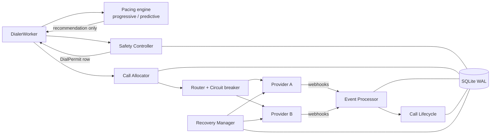
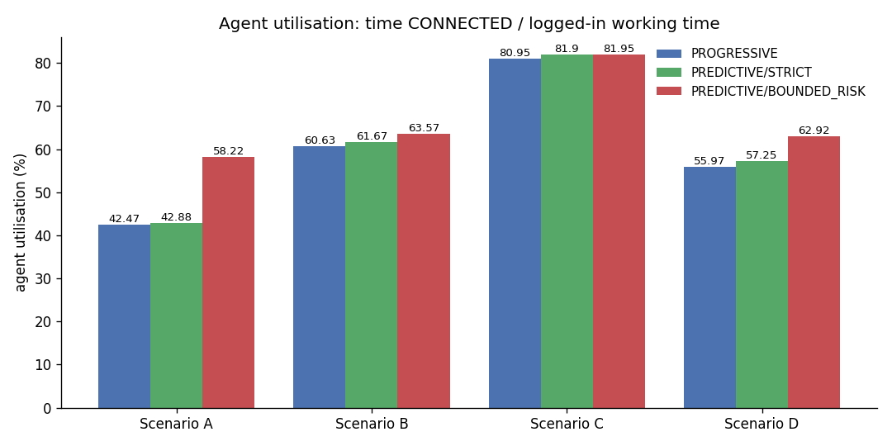
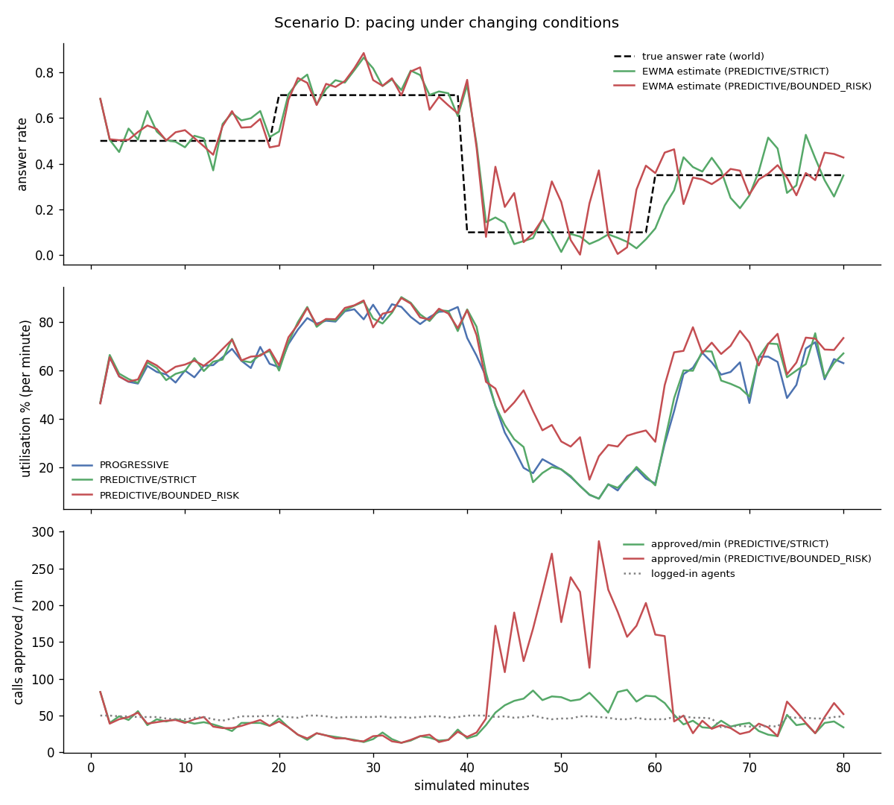

# SmartDialer

A safety-first **progressive and predictive outbound dialer** prototype for a collections team.
It shows atomic agent and borrower allocation, an independent Safety Controller that is the only
authority to place calls, idempotent handling of messy telecom webhooks, crash recovery, circuit
breakers, and a reproducible simulation comparing dialing strategies. Every number in this README
comes from running the code in this repository.

**GitHub:** https://github.com/vignan-puram/Smart-Dailer (diagrams render there automatically)

---

## 1. Project overview

* **Progressive mode:** one idle agent → one call. The agent is reserved *before* dialing.
* **Predictive mode:** a statistical pacing engine recommends how many calls to place. It is
  *advisory only*. An independent **Safety Controller** recomputes capacity from the database and
  approves, reduces, rejects or downgrades the request to progressive.
* **Two safety modes:**
  * `STRICT` (default): a deterministic guarantee that every pooled call has an agent free when it is answered.
  * `BOUNDED_RISK` (opt-in): probabilistic over-dial within an explicit risk budget ε.
* **Two mock telecom providers** with different reliability, duplicates, reordering and outages.
* A **simulation** of scenarios A–D in both modes, a **load test** at 100 / 1,000 / 10,000 agents,
  an **HTTP API** and a **CLI demo**.

## 2. Problem statement

Agents waste most of their time waiting for unanswered calls if the dialer dials one call per
agent. Dialing more calls than agents raises utilisation, but if more borrowers answer than there
are free agents, those connected calls are **abandoned**, which is unacceptable. The assignment asks
for higher utilisation **while ensuring connected borrower calls are not abandoned because of
insufficient agent capacity**, together with correctness under concurrency, duplicate and out-of-order
events, worker crashes and provider outages.

## 3. Features

| Area | What is implemented |
|---|---|
| Agents | 7-state machine, atomic CAS reservation, leases, deferred voluntary pause, immediate involuntary loss with rebind/cancel |
| Borrowers | atomic reservation, priority, retry limit, exponential backoff with jitter, DNC, one active call per borrower (DB-enforced) |
| Calls | 9-state forward-only machine, outcome codes, rank-based ordering, terminal protection |
| Progressive dialer | `min(idle, eligible, headroom)` BOUND calls, reserve-before-dial, cleanup on every failure path |
| Predictive engine | slow/fast EWMA answer rate, conservative cold start, expected-free-agents model, health/volatility factors, human-readable explanation |
| Safety Controller | own capacity queries in `BEGIN IMMEDIATE`, permits as DB rows, global/campaign/borrower limits, progressive fallback, deficit cancellation, persisted decisions |
| Events | persistent inbox (`UNIQUE(provider,event_id)`), duplicates, out-of-order, late, orphan, crash-safe, late answer after cancel → hangup |
| Recovery | expired leases, ambiguous timeouts reconciled with `get_call_status`, silent calls, consistency repair, idempotent |
| Providers | A (fast, reliable) and B (slow, flaky, duplicating, reordering), seeded, outages, webhook buffering |
| Circuit breaker | CLOSED→OPEN→HALF_OPEN→CLOSED, persisted, exponential backoff + jitter, single probe |
| Observability | structured JSON logs, `safety_decisions` table, metrics endpoint |

## 4. Architecture



The pacing engine cannot dial. The allocator dials only by atomically consuming slots of a
permit row that the Safety Controller wrote. Details: [docs/architecture.md](docs/architecture.md),
[docs/state_machines.md](docs/state_machines.md), [docs/architecture_decisions.md](docs/architecture_decisions.md).

## 5. Technology stack

Python 3.11+ (developed on 3.12; a fresh install from these instructions also passes all 154 tests
on Python 3.14 with the newest library releases), FastAPI + Uvicorn, Pydantic v2, SQLite (stdlib `sqlite3`, WAL),
pytest, matplotlib. There is no ORM: the concurrency guarantees are expressed directly as conditional SQL
statements in one repository module, which keeps them easy to review. There is no Kafka or Redis either
(ADR-001).

## 6. Folder structure

```
smartdialer/
├── app/
│   ├── main.py                 FastAPI app
│   ├── config.py               frozen configuration (+ env overrides)
│   ├── clock.py                virtual clock + event scheduler
│   ├── faults.py               crash-injection hooks for tests/demos
│   ├── logging_setup.py        structured JSON logging
│   ├── runtime.py              wires every component together
│   ├── models/                 agent, borrower, call, campaign, provider_event, safety
│   ├── database/               connection (transactions), schema (constraints), repositories (all SQL)
│   ├── providers/              base interface, mock engine, provider A/B, circuit breaker, router
│   ├── services/               agent/borrower/campaign managers, progressive dialer, predictive engine,
│   │                           safety controller, call allocator, call lifecycle, event processor,
│   │                           recovery manager, dialer worker
│   ├── simulation/             scenarios, simulator, metrics, charts, failure scenarios
│   └── api/                    routes, request schemas
├── tests/                      12 test modules (154 tests)
├── scripts/                    run_simulation.py, run_load_test.py, demo.py
├── docs/                       architecture, state machines, ADRs
├── results/                    generated simulation + load-test reports and charts
├── requirements.txt
└── .env.example
```

## 7. Installation

```powershell
cd smartdialer
python -m venv .venv
.venv\Scripts\activate          # macOS/Linux: source .venv/bin/activate
pip install -r requirements.txt
```

If PowerShell refuses to run `activate` (execution policy), skip activation and call the venv's
Python directly. Every command below then becomes `.venv\Scripts\python.exe ...`, for example
`.venv\Scripts\python.exe -m pytest -q`.

## 8. Environment configuration

All settings have safe defaults. Copy `.env.example` and export the variables you need (the app
reads environment variables; it does not load `.env` files itself):

| Variable | Default | Meaning |
|---|---|---|
| `SMARTDIALER_SAFETY_MODE` | `STRICT` | `STRICT` or `BOUNDED_RISK` |
| `SMARTDIALER_ABANDON_EPSILON` | `0.01` | risk budget per admission (BOUNDED_RISK only) |
| `SMARTDIALER_MAX_OUTSTANDING_CALLS` | `5000` | global cap on calls in flight |
| `SMARTDIALER_DB_PATH` | `data/smartdialer.db` | API database file (`:memory:` allowed) |
| `SMARTDIALER_SEED` | `42` | seed for providers and jitter |

All other tunables (EWMA α, lease lengths, breaker thresholds, wrap-up time…) live in frozen
dataclasses in `app/config.py`.

## 9. Database setup

Nothing to do. The schema (`app/database/schema.py`) is created automatically on start-up. The API
deletes and recreates its database file on each start, so every demo starts clean. Tests and
simulations use in-memory or temporary databases. Key constraints:
* partial unique indexes give one active call per agent and one per borrower;
* `UNIQUE(borrower_id, attempt_seq)` and `UNIQUE(provider, provider_call_id)` on calls;
* `UNIQUE(provider, event_id)` on the event inbox;
* `CHECK(consumed <= approved)` on dial permits;
* `CHECK` constraints that tie agent and borrower status to their call id.

## 10. Running the application

```powershell
uvicorn app.main:app --reload
```

Open http://127.0.0.1:8000/docs for interactive Swagger UI (the bare address redirects there). Time is **virtual**: nothing happens
until you call `POST /dialer/cycle` or `POST /time/advance`.

CLI demo without a server:

```powershell
python scripts/demo.py            # all sections
python scripts/demo.py pacing     # or: safety | failures
```

## 11. Running tests

```powershell
python -m pytest -q
```

The latest run gave **154 passed** in ~45 s (the longest test simulates 3,400 s of scenario D).

The concurrency tests use real threads on a file-backed database, so thread interleaving differs
on every run. One assertion in an earlier version was timing-dependent: it counted a legitimately
failed call setup as an extra borrower. It was fixed to assert the real invariant, no double-booking
among active calls, and that test file then passed 10 runs in a row. A 40-run stress check of the same
scenario never found an agent or borrower with two active calls.

## 12. Running simulations

```powershell
python scripts/run_simulation.py                      # A, B, C, D × 3 modes, seed 42
python scripts/run_simulation.py --scenarios A B --duration 1200 --seed 7
python scripts/run_simulation.py --epsilon 0.005      # tighter BOUNDED_RISK budget
```

Outputs: `results/simulation_results.md`, `results/simulation_results.json`, and charts in `results/`.

## 13. Running load tests

```powershell
python scripts/run_load_test.py                       # 100, 1,000, 10,000 agents, 8 workers
python scripts/run_load_test.py --agents 100 1000 --workers 4
```

Outputs: `results/load_test_results.md` and `.json`.

## 14. API documentation

| Method & path | Purpose |
|---|---|
| `GET /health` | status, virtual time, safety mode |
| `POST /reset` | fresh database |
| `POST /time/advance` `{seconds, dial}` | advance virtual time (pacing + recovery run inside) |
| `POST /agents` `{count, prefix, status}` | create agents |
| `GET /agents?status=` | list agents + counts |
| `POST /agents/{id}/status` `{status}` | AVAILABLE / PAUSED / OFFLINE (pause and logout are deferred while busy) |
| `POST /agents/{id}/disappear` | simulate involuntary agent loss |
| `POST /campaigns` `{id, name, mode, max_attempts, retry_delay_s, max_concurrent_calls}` | create campaign |
| `GET /campaigns` | list campaigns |
| `POST /campaigns/{id}/borrowers` `{count}` | create dummy borrowers |
| `GET /borrowers?campaign_id=` | list borrowers + counts |
| `POST /campaigns/{id}/start` / `pause` | campaign control |
| `PUT /campaigns/{id}/mode` `{mode}` | PROGRESSIVE / PREDICTIVE |
| `POST /dialer/cycle` | one pacing cycle: recommendation + explanation, safety decision, allocation |
| `GET /calls?status=` · `GET /calls/{id}` | call states; a single call includes its event history |
| `GET /providers/health` · `POST /providers/{name}/outage` `{active, webhooks}` | breaker state; inject outage |
| `GET /safety/decisions` | every decision with reason, limits and capacity snapshot |
| `GET /metrics` | agent/call counts, outcomes, abandons, duplicates, pacing stats |
| `POST /recovery/run` | run recovery/reconciliation now |
| `POST /simulations/run` `{scenario, mode, safety_mode, duration_s, seed}` | run a simulation |
| `POST /failures/{name}` | `worker_crash`, `worker_crash_before_initiate`, `provider_outage`, `agent_drop`, `duplicate_events`, `out_of_order_events`, `crash_after_answered` |

Example session:

```powershell
curl.exe -X POST localhost:8000/agents -H "content-type: application/json" -d '{\"count\": 10}'
curl.exe -X POST localhost:8000/campaigns -H "content-type: application/json" -d '{\"id\":\"c1\",\"name\":\"Demo\",\"mode\":\"PREDICTIVE\"}'
curl.exe -X POST localhost:8000/campaigns/c1/borrowers -H "content-type: application/json" -d '{\"count\": 500}'
curl.exe -X POST localhost:8000/campaigns/c1/start
curl.exe -X POST localhost:8000/dialer/cycle
curl.exe -X POST localhost:8000/time/advance -H "content-type: application/json" -d '{\"seconds\": 300}'
curl.exe localhost:8000/metrics
```

## 15. Example outputs

### Simulation results (real run: `python scripts/run_simulation.py`, seed 42, ε = 1%)

50 agents, 8,000 dummy borrowers, providers A/B weighted 70/30 (B duplicates 15% of webhooks and
reorders 10%), agents take voluntary 2–5 minute breaks (2% per agent per minute), wrap-up is 15s.
A–C run for 3,600 simulated seconds and D runs for 4,800. Full table, with all 14 metrics, in
[results/simulation_results.md](results/simulation_results.md).

| Scenario | Mode | Utilisation % | Connects / agent-hour | Calls initiated | Connected | Abandoned | Safety decisions (approved / reduced / fallback / rejected) | Capacity cancels |
|---|---|---|---|---|---|---|---|---|
| A (20%, 120s) | Progressive | 42.47 | 13.95 | 3,367 | 657 | **0** | 2134 / 0 / 0 / 0 | 0 |
| | Predictive STRICT | 42.88 | 14.07 | 3,390 | 661 | **0** | 0 / 2049 / 0 / 1551 | 0 |
| | Predictive BOUNDED_RISK | **58.22** | **18.78** | 4,628 | 903 | **0** | 1 / 704 / 137 / 2334 | 357 |
| B (50%, 90s) | Progressive | 60.63 | 25.48 | 2,426 | 1,205 | **0** | 1769 / 0 / 0 / 0 | 0 |
| | Predictive STRICT | 61.67 | 26.00 | 2,471 | 1,231 | **0** | 0 / 1550 / 0 / 2050 | 0 |
| | Predictive BOUNDED_RISK | 63.57 | 26.60 | 2,522 | 1,257 | **0** | 0 / 1297 / 112 / 2180 | 0 |
| C (70%, 180s) | Progressive | 80.95 | 18.42 | 1,247 | 888 | **0** | 1031 / 0 / 0 / 0 | 0 |
| | Predictive STRICT | 81.90 | 18.56 | 1,258 | 894 | **0** | 0 / 951 / 0 / 2649 | 0 |
| | Predictive BOUNDED_RISK | 81.95 | 18.56 | 1,249 | 888 | **0** | 0 / 901 / 132 / 2557 | 0 |
| D (changing, outage, agent drop) | Progressive | 55.97 | 17.95 | 3,349 | 1,112 | **0** | 2327 / 0 / 0 / 0 | 0 |
| | Predictive STRICT | 57.25 | 18.16 | 3,330 | 1,120 | **0** | 0 / 2109 / 13 / 2677 | 2 |
| | Predictive BOUNDED_RISK | **62.92** | **20.65** | 5,526 | 1,278 | **0** | 103 / 1118 / 168 / 2820 | 922 |

Scenario D: the answer rate and talk time change every 20 minutes (50%/90s → 70%/180s → **10%**/60s →
35%/150s). Provider A has an outage from 50:00 to 55:00 (5 circuit openings), and 30% of agents vanish
involuntarily at 66:40, returning at 73:20.




**How to read it:**
* **Utilisation** = time CONNECTED ÷ time in any working state (AVAILABLE, RESERVED, DIALING,
  CONNECTED, WRAP_UP), sampled every simulated second. PAUSED and OFFLINE time are excluded.
* **Zero abandoned calls in all 12 runs.** For STRICT this is guaranteed by construction. For
  BOUNDED_RISK it is an *observed* result at ε = 1%, not a guarantee.
* **STRICT predictive ≈ progressive** (+0.4 to +1.3 points). That is the honest price of a deterministic
  guarantee: calls in flight can never exceed agents who are *certain* to be free, which is
  almost what progressive does. The predictive engine keeps asking for more, and the Safety
  Controller reduces or rejects it (see the decision counts). This is the separation working as designed.
* **BOUNDED_RISK** gains the most where the answer rate is low: **+15.8 points and +35%
  connects per agent-hour in scenario A**, and +7 points in D, carried by the 10% phase. Its cost is
  **capacity cancellations**: ringing calls hung up because answers came faster than expected (357 in A, 922 in
  D, which includes the agent drop). Each of those is a short ring at a borrower with no conversation.
* The 2 STRICT capacity cancels in D both come from the *involuntary* agent drop. A run of the same scenario
  stopped at t = 3,990s has 0. ("Avg idle" in the full table counts AVAILABLE agents. In progressive
  mode a waiting agent is DIALING, not AVAILABLE, so it reads ~0 even though the agent is not talking.)

### The predictive engine explains itself, and safety overrules it (`python scripts/demo.py pacing`)

```
--- PREDICTIVE (last pacing cycle at t=600s) ---
Requested 38 calls because:
  * 18 agents idle, 0 finish wrap-up within 10s, ~3.3 of 32 conversations end within 10s (avg talk 93s) -> 21.3 agents expected free
  * answer rate rising (fast EWMA 36.8% > slow 36.6%): using 36.8%
  * target in-flight dials = 21.3 / 0.37 = 57.9
  * provider health is GOOD (factor 1.0)
  * 18 pooled calls already ringing (18 ringing in total)
  * safety margin is 1
  * 4633 eligible borrowers, campaign headroom 950
Safety Controller: REJECTED 0/38 - no safe capacity: agent_capacity=0
```

### No bypass (`python scripts/demo.py safety`)

```
"requested": 100, "approved": 10, "decision": "REDUCED", "reason": "reduced to 10: limited by agent_capacity=10"
allocator used 10 of 10 permit slots: 9 placed, 0 setup failed, 1 ambiguous (provider timeout)
a second execute of the same permit -> refused: permit ... is EXHAUSTED / expired
```

The "1 ambiguous" is a real Provider B timeout. That agent and borrower stay reserved until
recovery asks the provider what happened (ADR-009).

### The five failure cases from the assignment (`python scripts/demo.py failures`, real output)

| Case | What happened |
|---|---|
| **1. Worker crash** (agent reserved → borrower reserved → call initiated → crash) | State left: call RESERVED, agent and borrower still reserved, 2 webhooks lost. A second worker's cycle places **0** calls (nothing is free, so no duplicate). Recovery asks the provider by `client_ref`, **adopts** the real state (RINGING), and the call completes CONNECTED. **1 call** exists for that borrower. A crash *before* initiate instead ends CANCELLED_NOT_PLACED, the agent is released, and the borrower is retried without losing an attempt. |
| **2. Provider outage** (single provider, 180s of timeouts, 20 calls in flight) | **New calls:** the circuit opens within ~20s, and decisions switch to FALLBACK_TO_PROGRESSIVE with one probe call each time the cooldown expires (7 timeouts in total over the outage). **Existing calls:** reservations are kept and reconciled; in-flight calls drain from 15 to 2. **Retries:** no blind retries of initiate; backoff doubles per opening. **Pacing:** recovers once the circuit closes at t = 315s, with 54 calls placed afterwards. 0 abandoned, 0 unresolved. |
| **3. 100 agents, 40 vanish in 3s** | Within **1 second** (the next pacing tick) the decision goes from REDUCED to **REJECTED**. Bound calls of vanished agents are rebound or cancelled synchronously. **13 excess ringing pooled calls** are cancelled by the deficit check. From t + 5s the ≥ 20% drop rule forces FALLBACK_TO_PROGRESSIVE. **0 abandoned.** |
| **4. Duplicate events** (RINGING, ANSWERED ×3, COMPLETED) | APPLIED, APPLIED, DUPLICATE, DUPLICATE, APPLIED. One state transition and **one agent connection**. |
| **5. Out-of-order events** (COMPLETED, ANSWERED, RINGING) | APPLIED, TERMINAL_PROTECTED, TERMINAL_PROTECTED. Final: COMPLETED/CONNECTED, agent in WRAP_UP, borrower COMPLETED. |
| Crash right after ANSWERED, then COMPLETED arrives | The ANSWERED transaction rolled back entirely. COMPLETED(answered=true) is applied as an implied answer, and the final state is consistent. |

### Load test (real run: `python scripts/run_load_test.py`, 8 concurrent workers, file-backed SQLite WAL)

Machine: Windows 11 laptop, Intel 12th-gen (Family 6 Model 154), Python 3.12.1, SQLite 3.43.1.
Two borrowers per agent. Full output: [results/load_test_results.md](results/load_test_results.md).

| Agents | Agent reservations/s | Borrower reservations/s | Calls placed (8 workers) | Calls initiated/s | Safety eval alone p50 / p99 | Safety eval under contention p50 / p99 | Events/s (20% duplicates) | Invariants |
|---|---|---|---|---|---|---|---|---|
| 100 | 586 | 812 | 100 / 100 | 147 | 0.5 / 1.1 ms | 1.7 / 649 ms | 736 | PASS |
| 1,000 | 1,737 | 1,800 | 1,000 / 1,000 | 220 | 1.2 / 2.5 ms | 2.3 / 667 ms | 904 | PASS |
| 10,000 | 4,235 | 3,542 | 10,000 / 10,000 | 296 | 14.1 / 19.2 ms | 57.7 / 2,265 ms | 810 | PASS |

"Invariants" means: every agent and borrower reserved exactly once, never more than one active call per
agent or borrower, every duplicate webhook detected, and no agent left stranded. The reservation
columns are the median of 3 repetitions. The small-N phases finish in well under a second, so they
are dominated by thread start-up and are noisy.

**What breaks first, and why (from these numbers):**
1. **The single SQLite writer.** Events/s stays flat at ~750–900 whether there are 100 or 10,000
   agents, because every webhook transaction serialises on the same write lock. More workers do not help.
   Under contention, the p99 safety evaluation reaches 0.65–2.3 s. That is time spent *waiting for the lock*:
   SQLite's busy handler sleeps and retries (up to 100 ms per sleep) instead of queueing waiters.
2. **Capacity queries grow with table size.** Uncontended `evaluate` rises from 0.5 ms to 14 ms
   between 100 and 10,000 agents, because it runs `COUNT(*)` over agents, calls and especially eligible
   borrowers. At 100,000 agents that extrapolates to roughly 140 ms per evaluation, *inside* the global
   write lock, once per campaign per second.
3. **Rough budget at 10,000 agents:** scenario A's progressive rate (67 calls per agent-hour) means about
   190 calls/s and about 650 webhooks/s. This machine sustains about 300 calls/s *or* about 800 events/s,
   each phase measured alone. Combined, 10,000 agents is already at the limit of one SQLite writer.

**How to fix it** (ADR-007, ADR-013), in order:
* PostgreSQL row-level locking, so writers on different rows stop blocking each other.
* `evaluate` serialised per agent pool with `pg_advisory_xact_lock(pool)` instead of the database-wide lock.
* Maintained counters per pool instead of `COUNT(*)`.
* Partitioning by agent pool, so each worker group owns a slice of agents, calls and permits.
* Webhook ingestion partitioned by call id.

**Two fixes the load test already produced:**
* Indexes matching the ORDER BY of the agent and borrower pick queries. Before them, each reservation sorted every
  eligible row: about 9 ms per borrower pick at 20,000 borrowers, now about 0.02 ms.
* A real concurrency bug: unspent permits were not counted against the global and campaign call caps, so
  8 workers exceeded the 5,000-call cap by 163. Fixed in `SafetyController._capacity`; regression test:
  `tests/test_safety.py::TestHardAdmissionLimit::test_unspent_permits_count_against_global_and_campaign_limits`.

## Answer to the final question

> *How would you build a SmartDialer that gets as much of the utilisation benefit of predictive
> dialing as possible, while retaining the deterministic safety characteristics of progressive dialing?*

**Separate "how many calls can be answered at once" from everything else. Make the first
deterministic, and let prediction optimise only the rest.**

1. **A deterministic envelope that prediction cannot widen.** Pooled calls are admitted only while
   every unanswered call is backed by an agent who is *certain* to be free when it could first be
   answered: `U + S ≤ A` and `new ≤ A − (U + S) + W`. The Safety Controller computes this from
   the database with its own queries, inside one serialised transaction. It is true for *any* answer
   rate, so a wrong estimate costs utilisation, never an abandon. The engine can only ask
   (`safety_controller.py`).
2. **Grow the envelope by turning uncertainty into guarantees, not by guessing:**
   * system-enforced wrap-up deadlines, so agents finishing wrap-up before the earliest possible answer
     are known capacity (W);
   * voluntary pause or logout is *deferred* while a pooled call depends on that agent, so availability is a commitment, not a hope;
   * late binding: any free agent takes whichever call is answered first;
   * a measured per-provider minimum dial-to-answer delay. The longer that guaranteed floor, the more
     wrap-up agents can back new calls.
3. **Spend prediction where it is safe: who and when, not how many.** Order borrowers by answer
   likelihood (time of day, history), tune ring timeouts and retry timing. These raise
   connects per agent-hour without raising the number of simultaneous answers.
4. **Be explicit about the ceiling.** In this simulation the deterministic design gains only +0.4 to
   +1.3 utilisation points over progressive, because most of predictive's benefit comes from betting
   on no-answers. A determinism-preserving dialer cannot make that bet. If the business accepts a
   quantified risk, an opt-in `BOUNDED_RISK` mode does it under strict rules:
   * a binomial bound at a pessimistic answer rate, with ε = 1%;
   * automatic fallback to progressive when data is thin, the rate is unstable, providers degrade, or agents drop;
   * the cancel-on-deficit enforcer.

   Here it gave **+15.8 points in scenario A** and +7 in D with zero abandons, at the cost of
   short-ring hang-ups. That is a compliance decision, so it is off by default.

## Answers to the discussion questions

**Two workers try to reserve the same agent at exactly the same time. What happens?**
Neither worker reads and then writes. Each runs one conditional statement:
`UPDATE agents SET status='RESERVED', current_call_id=? WHERE id=? AND status='AVAILABLE'`.
SQLite serialises writers, so only the first statement still sees `AVAILABLE` and gets `rowcount = 1`.
The second gets `rowcount = 0` and moves on to the next agent (`AgentRepository.reserve_any`). If code ever
got this wrong, unique indexes on the agent's current call and on active calls per agent still refuse a second call.
Tests: `tests/test_concurrency.py::test_two_workers_reserving_the_same_agent` and
`tests/test_concurrency.py::test_naive_read_then_write_is_racy_but_conditional_update_is_not`.

**Your database says the agent is AVAILABLE, but your cache says RESERVED. Which one wins?**
The database, always. This design deliberately has no cache of agent state: every reserve, claim, release
and capacity check is an atomic statement in the database. If a cache were added later, for dashboards or
pre-filtering, it would only be a hint. A stale "AVAILABLE" in the cache costs one failed conditional
update (`rowcount = 0`). A stale "RESERVED" costs one missed chance for one cycle. Neither can
double-allocate.

**The provider sends ANSWERED, your worker crashes, and then COMPLETED arrives. What happens?**
The crash rolls back the whole ANSWERED transaction, including its inbox row, so the system is still
consistent. COMPLETED carries `answered=true` and the talk time, so it is applied as an *implied answer*:
the call ends COMPLETED/CONNECTED, the agent goes to WRAP_UP, and the borrower is COMPLETED. If the provider then
redelivers ANSWERED, the result is `TERMINAL_PROTECTED`.
Test: `tests/test_events.py::test_worker_crash_during_answered_then_completed_then_redelivery`.

**Your model predicted a 70% answer rate. It suddenly drops to 10%. How does the system protect itself?**
A drop is the safe direction: fewer answers than expected leaves agents idle, but it cannot
abandon anyone. The engine still adapts: the fast EWMA falls first, and while fast and slow differ by more than
50% the request is multiplied by 0.7. The dangerous direction is the reverse, 10% → 70%:
* the engine switches to the higher fast estimate as soon as answers rise;
* BOUNDED_RISK falls back to progressive while the rate is unstable;
* STRICT is unaffected, because its bound (`U + S ≤ A`) never uses the estimate.

Scenario D contains both changes (70% → 10% at 40:00, 10% → 35% at 60:00) and has 0 abandons in every mode.
Test: `tests/test_predictive.py::test_engine_adapts_when_answer_rate_collapses`.

**Why did your algorithm decide to initiate 17 calls instead of 10?**
Every recommendation carries its own arithmetic, returned by `POST /dialer/cycle` and stored with each
safety decision. The API example above (10 agents) shows exactly this case:
* 10 agents are idle;
* there are fewer than 30 answer samples, so the engine assumes a cautious 60% answer rate;
* 10 / 0.60 = **16.7, about 17 dials**, minus 0 already ringing, minus a safety margin of 1 = **15 requested**.

The Safety Controller then approved **10**, with the reason "reduced to 10: limited by agent_capacity=10",
because STRICT never lets unanswered calls exceed agents who are certain to be free. So the engine may say 17,
but the number actually dialled is set by safety, and the stored decision shows which limit applied.

**What part of your architecture are you least confident about?**
1. **The 3-second minimum answer delay** (`guaranteed_min_answer_delay_s`). Wrap-up look-ahead relies on it.
   It is realistic (call setup plus at least one ring), but it is a property of the carrier, not something
   the dialer enforces. In production it should be measured per provider, with an alarm.
2. **SQLite's single write lock.** Correct, but every campaign's safety decision waits on the same lock.
   Per-pool locks on PostgreSQL are the fix (ADR-007).
3. **BOUNDED_RISK's capacity cancellations.** Hanging up ringing calls keeps abandons at zero, but short-ring
   hang-ups may themselves be regulated. That mode needs a compliance review before anyone enables it.

**We just went from 1,000 to 100,000 agents. What breaks first?**
The single database writer. Every reservation, webhook and safety decision serialises on it, and the
Safety Controller's `COUNT(*)` capacity queries grow with table size (14 ms at 10,000 agents, roughly
140 ms at 100,000, inside the write lock). The measured numbers are in the load-test section above. The fix is not
"more servers":
* partition by agent pool, so safety needs a consistent view of only one pool;
* PostgreSQL row-level locking with a lock per pool;
* maintained counters instead of `COUNT(*)`;
* webhook ingestion partitioned by call id.

Details in `docs/architecture_decisions.md` (ADR-013).

## 16. Known limitations

* **SQLite has a single writer.** Every reservation, event and safety decision serialises on one lock.
  This is correct, but it is the first bottleneck (see the load test).
* **Safety evaluation counts rows** (`COUNT(*)` over agents, calls and borrowers). That is ~14 ms at 10,000 agents and
  20,000 borrowers, dominated by the eligible-borrower count.
* **One agent pool per running campaign is assumed** for pool-level checks (`_reference_campaign`).
  Multi-campaign pools would need per-pool statistics.
* **Virtual time and mock providers.** There are no real HTTP webhooks, signatures or clock skew. Talk
  times are memoryless.
* **`guaranteed_min_answer_delay_s = 3`** is an assumption about carriers. It should be measured per provider.
* **BOUNDED_RISK hangs up ringing calls** (capacity cancels). Minimum-ring-duration rules
  in some jurisdictions would need to be checked before enabling it.
* **The demo API has no authentication or rate limiting,** and it serialises requests with a global lock.

## 17. Future improvements

1. PostgreSQL with `SELECT … FOR UPDATE SKIP LOCKED` claims and per-pool advisory locks for
   `evaluate`, plus maintained counters instead of `COUNT(*)` capacity queries.
2. Partitioning by agent pool, with each worker owning a pool through a lease table, so safety needs a consistent view
   of one pool only.
3. A real provider adapter (for example Plivo): signed webhook endpoint → inbox table, `client_ref` in call
   metadata, and status polling for reconciliation.
4. Prometheus metrics and alerts on abandon rate, capacity cancels, breaker state and deficit
   events. A supervisor dashboard reading `/metrics` and `/safety/decisions`.
5. Compliance rules: calling hours per borrower time zone, consent and DNC sync, and a per-campaign
   abandon-rate kill switch.
6. Shadow-mode evaluation of new pacing parameters against recorded event logs before rollout.
