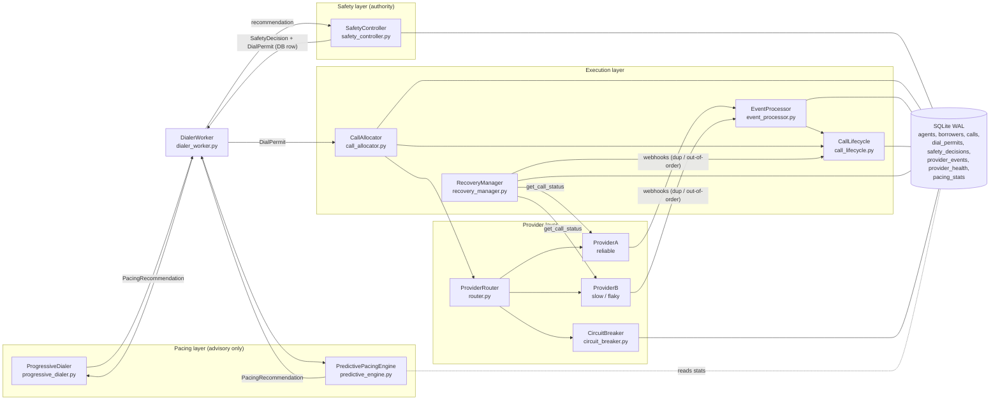

# SmartDialer architecture

A **modular monolith**: one Python process (or several identical worker processes), with one
SQLite database as the single source of truth. Components talk through plain method calls and
through the database. There is no message broker. All coordination between concurrent workers
happens through atomic SQL statements, so adding workers never changes correctness.

## Component diagram



**The one-way arrow that matters:** pacing engines produce a `PacingRecommendation` (a number plus an
explanation) and *nothing else*. They hold no reference to the allocator or to any provider
(`tests/test_predictive.py::TestAdvisoryOnly` checks the source code for this). The **only** way to
place a call is `CallAllocator.execute(DialPermit)`, and a permit is valid only if the
SafetyController wrote its row in `dial_permits`.

## One pacing cycle (`DialerWorker.run_cycle`)

```mermaid
sequenceDiagram
    participant W as DialerWorker
    participant E as Pacing engine
    participant S as SafetyController
    participant DB as SQLite
    participant A as CallAllocator
    participant P as Provider

    W->>DB: housekeeping (wrap-ups ended, deferred pauses)
    W->>S: observe_agents() / find_capacity_deficit()
    W->>E: recommend(campaign)
    E-->>W: requested=N, binding, explanation
    W->>S: evaluate(recommendation)
    S->>DB: BEGIN IMMEDIATE; recompute capacity with its own queries
    S->>DB: INSERT safety_decisions, INSERT dial_permits(approved=M); COMMIT
    S-->>W: decision (APPROVED / REDUCED / REJECTED / FALLBACK_TO_PROGRESSIVE)
    loop M times
        W->>A: execute(permit)
        A->>DB: txn: consume 1 slot, reserve borrower, [reserve agent], insert call
        A->>P: initiate_call
        P-->>A: accepted / rejected / timeout (ambiguous)
        A->>DB: INITIATED + agent DIALING (or release / keep for reconciliation)
    end
    P-->>W: webhooks later, via EventProcessor.handle
```

## Safety Controller workflow (`SafetyController.evaluate`)

1. Open `BEGIN IMMEDIATE`. No other worker can evaluate or reserve until commit.
2. `_capacity` runs its **own** COUNT queries: idle agents (excluding pause-pending), look-ahead
   wrap-ups, pooled calls not yet answered (U), unspent permit slots (S), active calls overall and
   per campaign, eligible borrowers, the answer-rate upper bound, and the provider health from the
   breaker table.
3. Hard rejections: campaign not RUNNING, nothing requested, all providers DOWN, or an existing
   capacity deficit.
4. For UNBOUND requests, `_fallback_reason` checks provider DEGRADED, an agent-availability drop of
   20% within 10s, and (BOUNDED_RISK only) fewer than 200 samples or an unstable rate. If any is true,
   the request is converted to BOUND (`FALLBACK_TO_PROGRESSIVE`).
5. `approved = min(requested, agent/risk capacity, global outstanding limit, campaign concurrency
   limit, eligible borrowers, [1 if only HALF_OPEN providers])`. The tightest limit is named in the
   reason.
6. Insert `safety_decisions` (snapshot, limits and the engine's explanation) and, if approved > 0,
   one `dial_permits` row with a 5s TTL. Commit, then emit a structured log line.

## Event-processing lifecycle (`EventProcessor.handle`)

```
webhook ──► BEGIN IMMEDIATE
             ├─ INSERT provider_events (UNIQUE provider,event_id) ── conflict? → DUPLICATE (count++) → COMMIT
             ├─ find call by client_ref / provider_call_id ── none? → ORPHAN
             ├─ call terminal?            → TERMINAL_PROTECTED (+ hang up a late ANSWERED after cancel)
             ├─ rank(event) ≤ rank(call)? → STALE
             ├─ apply: RINGING | ANSWERED (claim/connect agent) | COMPLETED (implied answer, finish)
             │         | FAILED → CallLifecycle.finish (agent + borrower released once, by CAS)
             ├─ UPDATE provider_events.result
             └─ COMMIT  ──► post-commit side effects (provider hangups)
```

A crash anywhere before COMMIT rolls back the inbox row **and** the state change together, so the
provider's retry is processed as if it were new (`tests/test_events.py::test_worker_crash_during_answered_then_completed_then_redelivery`).
A crash after COMMIT makes the retry a harmless `DUPLICATE`.

## Database interaction

* `app/database/connection.py::Database.transaction()` opens `BEGIN IMMEDIATE` for the outer
  transaction and a `SAVEPOINT` for nested ones. WAL mode allows readers to run alongside the writer.
  `busy_timeout` makes competing writers wait instead of failing.
* All SQL lives in `app/database/repositories.py` (agents, borrowers, calls, events, pacing stats,
  read-only metrics). Services contain no SQL except the SafetyController's private capacity queries,
  which are deliberately independent of `MetricsReader`.
* Schema and constraints: `app/database/schema.py`.

## Layers and their responsibilities

| Layer | Module | Responsibility | Must never |
|---|---|---|---|
| Pacing | `progressive_dialer.py` | `min(idle agents, eligible borrowers, headroom)`, BOUND | place calls |
| Pacing | `predictive_engine.py` | statistical target in-flight dials, UNBOUND, explanation | place calls, see allocator/providers |
| Safety | `safety_controller.py` | recompute capacity, approve/reduce/reject/fallback, issue permits, cancel on deficit | trust engine numbers |
| Execution | `call_allocator.py` | spend permit slots atomically, reserve, initiate | dial without a permit slot |
| Execution | `event_processor.py` | idempotent, ordered application of provider webhooks | apply an event twice or move backwards |
| Execution | `call_lifecycle.py` | the single place that ends a call and releases agent + borrower | release twice |
| Execution | `recovery_manager.py` | expired leases, silent calls, reconciliation via provider status, repairs | release an agent while the provider may hold a live call |
| Provider | `mock_provider.py`, `provider_a/b.py` | realistic latency, failure, duplicates, reordering, outages | — |
| Provider | `circuit_breaker.py`, `router.py` | persisted breaker state, weighted routing that skips OPEN circuits | — |

## Concurrency model

* **Atomic reservations without read-check-write.** Every claim is one statement:
  `UPDATE agents SET status='RESERVED', current_call_id=? WHERE id=? AND status='AVAILABLE'`, then
  check `rowcount`. Picking *any* free agent uses `UPDATE ... WHERE id = (SELECT ... LIMIT 1) AND
  status='AVAILABLE' RETURNING id` (`AgentRepository.reserve_any`, `BorrowerRepository.reserve_next`).
* **Serialised safety decisions.** `evaluate` runs in `BEGIN IMMEDIATE`, so two workers cannot both
  see the same free capacity. The second one sees the first one's outstanding permit slots
  (`tests/test_safety.py::test_concurrent_evaluations_never_over_approve`).
* **Constraints as the last line of defence.** Even if application code had a bug, the database refuses
  a second active call per agent or per borrower, a permit overspend (`CHECK consumed <= approved`), and an agent
  in a call state without a call id.
* **Leases.** A reservation carries `reserved_until` / a setup lease. If the worker dies, recovery
  reclaims the reservation **only after** asking the provider whether the call exists.

In PostgreSQL the same design maps to `SELECT ... FOR UPDATE SKIP LOCKED` for queue-style claims
and `SERIALIZABLE` (or an advisory lock per agent pool) for `evaluate`. See
`docs/architecture_decisions.md`.

## Failure handling summary

| Failure | Mechanism | Code |
|---|---|---|
| Worker crash before `initiate_call` | setup lease expires → provider says "unknown" → CANCELLED_NOT_PLACED, release | `RecoveryManager.run`, `reconcile_call` |
| Worker crash after `initiate_call` | provider knows the call by `client_ref` → adopt its state, no redial | `reconcile_call` → `adopted` |
| Ambiguous initiate timeout | keep reservations, reconcile after the lease expires | `CallAllocator._initiate` |
| Provider outage | breaker OPEN → routing skips it → DOWN ⇒ REJECTED, DEGRADED ⇒ fallback to BOUND | `circuit_breaker.py`, `SafetyController.evaluate` |
| Duplicate / out-of-order / late webhooks | inbox `UNIQUE(provider, event_id)`, rank check, terminal protection | `EventProcessor.handle` |
| Agent disappears | immediate OFFLINE, rebind or cancel bound call, deficit-cancel pooled calls | `AgentManager.disappear`, `RecoveryManager.handle_agent_lost`, `find_capacity_deficit` |
| Lost webhooks | silent-call reconciliation after `event_silence_reconcile_s` | `RecoveryManager.run` |
| Answer after cancel | hang up immediately, count it | `EventProcessor._apply` |

## Time

All components read time from a `Clock`. The simulator, tests and API use `SimClock` plus a
`Scheduler` (heap of timed provider callbacks), so a 80-minute scenario runs in under a minute,
fully deterministic for a given seed. A production deployment would swap in a wall clock and real
webhooks without touching the services.
