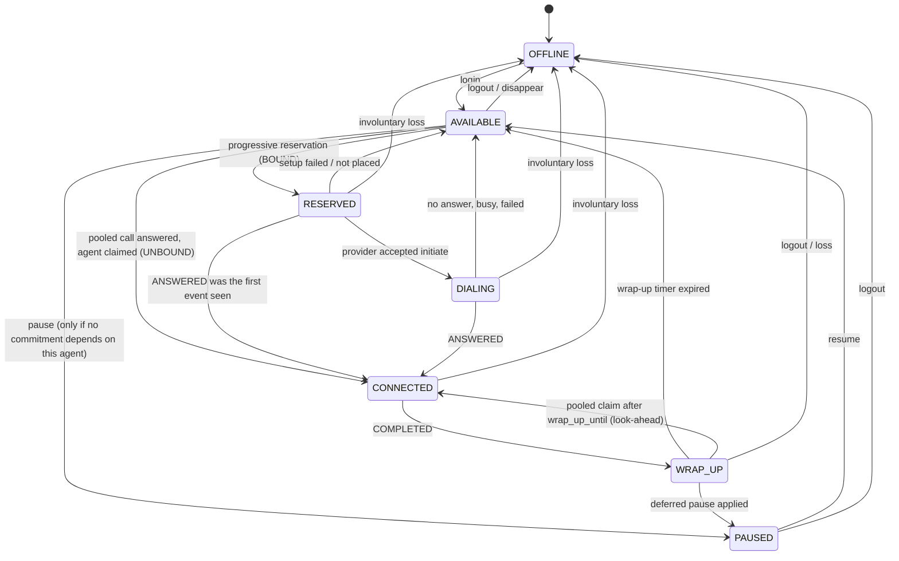
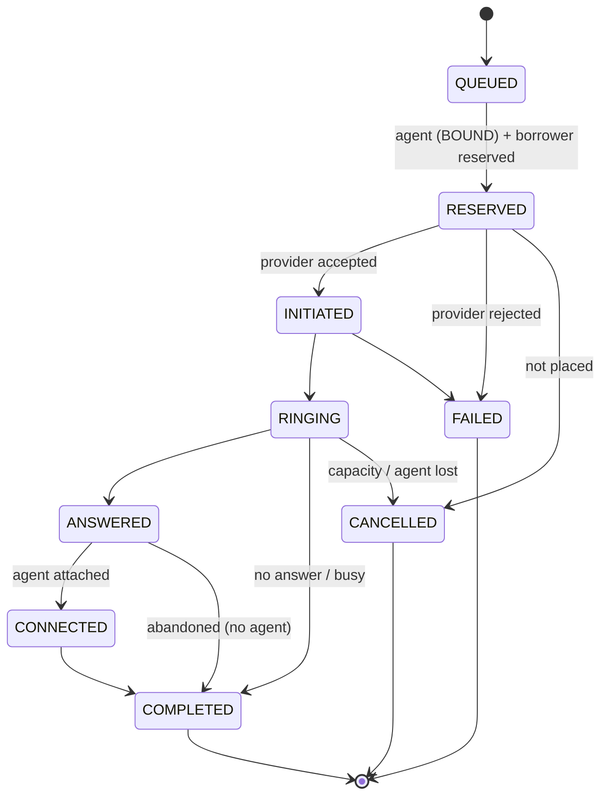
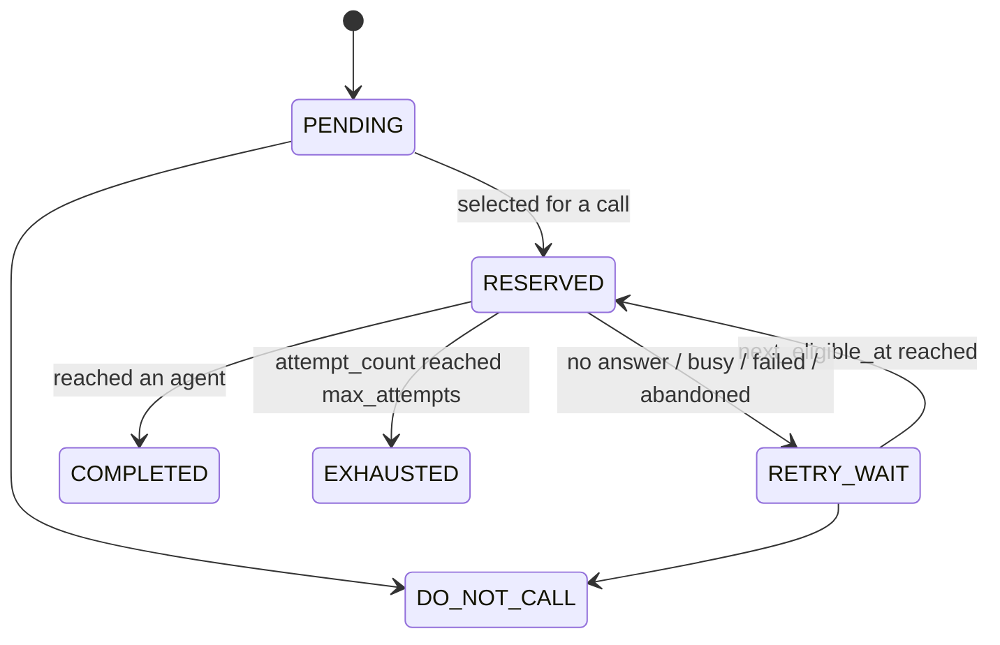

# State machines

There are three state machines: agent, call and borrower. Each one is enforced twice:

1. **In code**: a transition table plus a validator (`app/models/agent.py::AGENT_TRANSITIONS`,
   `app/models/call.py::CALL_TRANSITIONS`).
2. **In the database**: every state change is a *conditional* `UPDATE ... WHERE status = <expected>`
   (compare-and-set). If a concurrent worker already moved the row, `rowcount == 0` and the caller
   backs off. `CHECK` constraints stop impossible combinations from being stored at all
   (`app/database/schema.py`).

## Agent

| From | Allowed to | Who drives it |
|---|---|---|
| OFFLINE | AVAILABLE | `AgentManager.login` |
| AVAILABLE | RESERVED, CONNECTED, PAUSED, OFFLINE | allocator `AgentRepository.try_reserve/reserve_any`; event processor `claim_for_answered_call`; manager |
| RESERVED | DIALING, CONNECTED, AVAILABLE, OFFLINE | allocator `mark_dialing`; processor; lifecycle `release_from_call` |
| DIALING | CONNECTED, AVAILABLE, OFFLINE | processor `connect_bound`; lifecycle |
| CONNECTED | WRAP_UP, OFFLINE | `CallLifecycle.finish` |
| WRAP_UP | AVAILABLE, CONNECTED, PAUSED, OFFLINE | `end_expired_wrapups`; pooled claim |
| PAUSED | AVAILABLE, OFFLINE | manager |

**Invariants (DB `CHECK`):** `status IN (RESERVED, DIALING, CONNECTED)` ⇔ `current_call_id IS NOT NULL`.
`current_call_id` is `UNIQUE`, so one call can never hold two agents.

**Voluntary vs involuntary unavailability**
* *Voluntary* (pause/logout) while the agent is RESERVED/DIALING/CONNECTED/WRAP_UP, or while pooled
  calls in flight are relying on that agent's capacity, is **deferred**: `pause_requested = 1` is set,
  and it is applied when the agent becomes free (`AgentManager.request_pause`,
  `SafetyController.pooled_headroom`). Pause-pending agents are excluded from new capacity.
* *Involuntary* (crash or network, `AgentManager.disappear`) is **immediate**. The agent row is set to
  OFFLINE in one CAS, and `RecoveryManager.handle_agent_lost` then rebinds the BOUND call to another
  idle agent or cancels it. After that, `SafetyController.find_capacity_deficit` cancels any pooled calls that
  now exceed claimable agents.

**Invalid agent transitions (examples, all rejected by `validate_transition` and tested in
`tests/test_agents.py`):**

| Attempt | Why it is invalid |
|---|---|
| OFFLINE → RESERVED / CONNECTED | an agent who is not logged in can never get a call |
| PAUSED → RESERVED | a paused agent is not capacity |
| CONNECTED → AVAILABLE | skipping wrap-up; the conversation must end through `CallLifecycle.finish` |
| DIALING → RESERVED | backwards |
| any → RESERVED/DIALING/CONNECTED/WRAP_UP via the API | call-bound states belong to the dialer (`AgentManager.transition` raises) |

**Failure transitions:** RESERVED → AVAILABLE (setup failed, not placed, rejected),
DIALING → AVAILABLE (no answer, busy, network failure), any call-bound state → OFFLINE (involuntary
loss; the call is rebound, cancelled or marked AGENT_DROPPED by `RecoveryManager.handle_agent_lost`),
and agents stuck in a state for a call that is already terminal → AVAILABLE (consistency repair in
`RecoveryManager.run`).

## Call

Rules (`app/models/call.py`, `app/services/event_processor.py`):
* **Forward only.** Each status has a rank: QUEUED 0, RESERVED 1, INITIATED 2, RINGING 3, ANSWERED 4,
  CONNECTED 5, terminal 6. An event whose rank is ≤ the current rank is `STALE`. Skipping states is
  allowed (ANSWERED can be the first event we see).
* **Terminal states are final.** No outgoing transitions. Late events give `TERMINAL_PROTECTED`.
  One exception is a side effect, not a transition: a late `ANSWERED` for a call we already
  `CANCELLED` makes us **hang up** that live leg.
* **An answered call can never be CANCELLED**, because a person is on the line. Capacity cancellation is
  a *request* (`cancel_requested_at`). If the answer wins the race, the call is handled normally and
  the person is connected if an agent is free, otherwise it is counted as ABANDONED.
* **Outcome** (separate from status): CONNECTED, NO_ANSWER, BUSY, SETUP_FAILED, PROVIDER_FAILED,
  ABANDONED, AGENT_DROPPED, CANCELLED_AGENT_LOST, CANCELLED_CAPACITY, CANCELLED_NOT_PLACED, UNRESOLVED.

**Invalid call transitions (examples):** COMPLETED/FAILED/CANCELLED → anything (terminal);
ANSWERED → CANCELLED (someone is on the line); CONNECTED → RINGING (backwards; becomes `STALE`);
QUEUED → CONNECTED (a call must be reserved first). `CallRepository.transition` is a CAS on the
expected current status, so even a valid transition fails if another worker got there first.

**Failure transitions:**

| From | To / outcome | Trigger |
|---|---|---|
| RESERVED | FAILED / SETUP_FAILED | provider rejected `initiate_call` (definitive) |
| RESERVED | CANCELLED / CANCELLED_NOT_PLACED | lease expired and provider has no record of `client_ref` |
| RESERVED/INITIATED/RINGING | CANCELLED / CANCELLED_AGENT_LOST | bound agent vanished and no idle agent to rebind |
| RINGING | CANCELLED / CANCELLED_CAPACITY | pooled call in excess after agent loss (hung up first) |
| INITIATED/RINGING | FAILED / PROVIDER_FAILED | provider `FAILED` webhook |
| RINGING | COMPLETED / NO_ANSWER or BUSY | ring timeout / busy signal |
| ANSWERED | COMPLETED / ABANDONED | pooled answer found no claimable agent |
| CONNECTED | COMPLETED / AGENT_DROPPED | agent vanished mid-conversation |
| any active | COMPLETED/FAILED (reconciled) | provider status adopted by recovery after silence or a crash |

DB invariants: `UNIQUE(borrower_id, attempt_seq)`, `UNIQUE(provider, provider_call_id)`, partial
unique indexes giving **one active call per borrower** and **one active call per agent**.

## Borrower

* `status = RESERVED` ⇔ `active_call_id IS NOT NULL` (DB `CHECK`).
* Retry backoff is `retry_base_delay_s · 2^(attempts-1)` with jitter, capped at `retry_max_delay_s`
  (`borrower_manager.retry_delay`).
* Failures that never reached the borrower's phone (SETUP_FAILED, CANCELLED_NOT_PLACED,
  PROVIDER_FAILED) **do not count as an attempt** and are retried after 30s.
* ABANDONED (the borrower answered and no agent was free) is retried promptly, after 60s.
